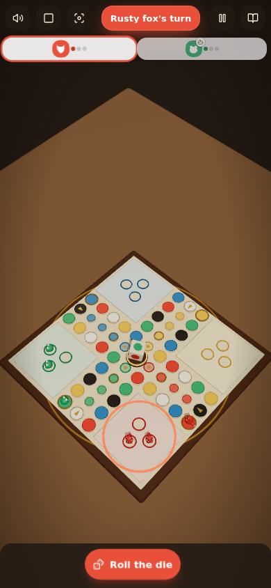
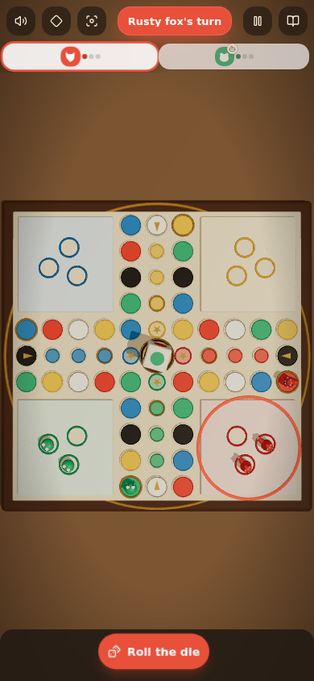
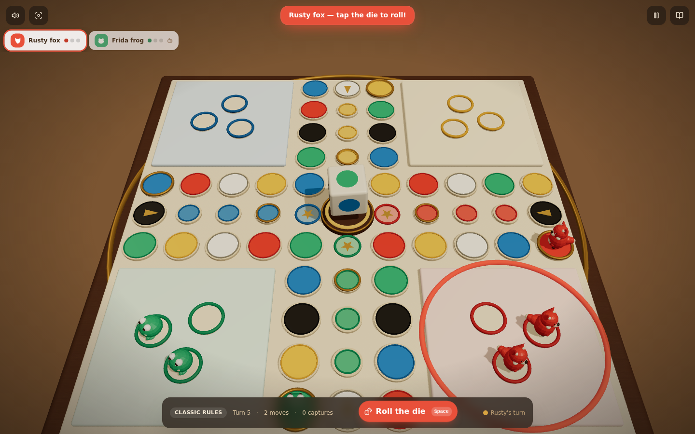

# Mensch ärgere Dich nicht® Kids — 3D Board Game

A warm, kid-friendly 3D digital adaptation of the children's edition of the German
classic *Mensch ärgere Dich nicht* — 2 to 4 players, ages 4 and up, races of about
10–15 minutes. The whole game runs in the browser: a fully modeled wooden board,
animated animal pawns, a color die that tumbles on its pedestal, and a rules engine
that follows exactly what a child sees painted on the board.

| Diagonal view (phones) | Top-down view (phones) | Desktop |
| --- | --- | --- |
|  |  |  |

> The ruleset implemented here is **kids-v6** — a careful, openly documented
> reconstruction of the Kids edition. `RULES.md` separates verified edition facts,
> documented assumptions and optional variants; nothing is silently invented.

---

## Features

### Gameplay

- **Click-to-move** — every legal destination is highlighted with a golden ring and
  is itself a tap target: press the glowing pawn *or* the highlighted platform and
  the move plays. Tapping an enemy pawn standing on a capture target performs the
  capture.
- **The journey is the paint** — a pawn walks to the *next field showing the rolled
  color* along a 43-position journey: the woven track (player colors + white/black
  platforms) and the private home stretch, all exactly as painted on the board.
- **The golden arrow gateway** — the arm tip is a mandatory stop on the way home:
  no pawn may jump over it; only the own color steps from the gateway into the row.
- **Home-stretch protection** — the finish zone is pass-free under every rule set:
  nobody is ever jumped there, and each finish slot holds exactly one pawn.
- **Human-like die** — the die physically tumbles on its pedestal, settles on the
  engine's rolled face, and optional *Ceramic Dice* mode keeps rolls fair without
  ever feeling unfair (a gentle exit mercy when a player is stuck in the base, and
  a small win-chance bonus on the decisive roll — every bias is documented in-game).
- **Smart helpers for kids** — single legal move auto-plays after a short highlight,
  illegal taps shake and explain themselves in friendly language, and an accessible
  pawn-picker row mirrors the 3D tap targets.
- **Robot opponents** — three AI levels with human-like delays; mixed human/robot
  tables of 2–4 players.

### Rules & presentation

- **Four rule presets** — Classic, Quick Game, Family Mode and fully editable
  Custom Rules (entry rule, blocking, finish rule, protected starts, capture,
  stacking, own-color turns, skip move, star die, and more) with per-option
  explanations and safe preset switching.
- **Board layouts** — the Classic Official Color Pattern or the Full Random Map
  (every track field and finish slot re-colored, home stretches included).
- **Seasons & full customization** — classic, winter, Christmas, Easter and
  summer themes with weather and scenery; wooden board skins; **platform-tile
  skins** (smooth classic inlays, faceted low-poly gems, plush cushions,
  glossy porcelain with golden rims); **dice skins** (ivory classic, wooden
  toy, crystal, midnight glow); six pawn skins with color-matched accessories.
  Gameplay colors are never affected — ownership stays instantly readable.
- **Calm HUD by default** — the play-by-play roll narration ("Frida Frog
  rolled Blue — no pawn can use it. Turn skipped.") is OFF by default and can
  be re-enabled from the pause menu ("Roll announcer").
- **Composed background music** — each of the three synthesized sound packs
  (Toy shop, Christmas bells, Arcade chip) carries its own hand-written
  multi-layer tune — chord pad, bass line, lead melody, counter-arp and light
  percussion — cycling forever from the first tap on the menu onward.
- **Saved play** — automatic autosave of the running match, last setup restore,
  and a persistent match history backed by a small API + database.
- **Interactive tutorial** — a "Would you like to take an interactive tutorial?"
  intro (Start / Read the manual / Don't show again) and a step-by-step guided
  tour that works on touch and mouse.

### Mobile & accessibility

- **Two portrait camera framings** — the kids' *diagonal* diamond (tuned close:
  the board's corners land at the screen edges so every pawn position fills the
  view) and a *straight top-down* view whose board edges butt against the screen
  sides; both are solved exactly against the perspective projection for any
  phone aspect and switchable from the in-game HUD. The **reset camera view**
  button always restores the default angled framing (never the overhead one).
  Landscape/desktop keeps the classic three-quarter camera.
- **Safe-area aware HUD** — `100dvh`/`100svh` layout, `env(safe-area-inset-*)`
  padding, sticky bottom gameplay bar with reserved status space, no horizontal
  scrolling, and touch targets sized for small hands.
- **Keyboard & screen readers** — Space to roll, full Radix-based focus and ARIA
  wiring, `prefers-reduced-motion` respected across every animation, and semantic
  landmarks throughout.

---

## Tech stack

| Layer | Choice |
| --- | --- |
| Framework | Next.js 16 (App Router) + TypeScript 5 |
| 3D | React Three Fiber + drei + three.js |
| UI | Tailwind CSS 4 + shadcn/ui (New York) + Lucide icons |
| State | Zustand (game + settings, with `localStorage` persistence) |
| Database | Prisma (SQLite) for the match-history API |
| Animation | Framer Motion (HUD) + hand-written tweening (3D layer) |

## Getting started

```bash
# install dependencies
bun install

# create the database used by the match history (optional — the game runs without it)
bun run db:push

# start the dev server
bun run dev
```

Then open the printed local URL in a browser. Other useful commands:

```bash
bun run lint        # ESLint (Next.js rules)
bun run typecheck   # TypeScript, no emit
bun run build       # production build
bun run test        # engine unit tests
```

## How the project is organized

```
src/
  engine/            # the pure rules engine — no React, no three.js
    board.ts         #   loop, home rows, gateways, cell math
    boardTrackConfig.ts # the authoritative track paint (classic + random layouts)
    rules/           #   legal-move pipeline: path, destination, occupancy
    game.ts          #   turn flow, star resolution, pass/advance
    dice.ts          #   face probabilities & ceramic-dice fairness
    ai.ts            #   robot move & star-color choice
  store/             # zustand stores (game flow + persisted settings)
  components/
    game/            # the 3D layer: board, pawns, die, camera rig, canvas
    hud/             # menu, setup, rules screen, in-game HUD, dialogs
  app/api/           # match-history REST endpoint
  config/            # themes, skins, tuning constants
RULES.md             # the full ruleset research & specification
docs/screenshots/    # the pictures above
```

The engine is deliberately presentation-free: the 3D scene animates *what the
engine already decided* and reports animations back through tokens, so a dropped
frame can never change a rule outcome.

## Controls

| Action | Input |
| --- | --- |
| Roll the die | Tap the die / the **Roll the die** button / `Space` |
| Move a pawn | Tap the glowing pawn or its golden target platform |
| Orbit the camera | Drag (two views on portrait phones via the HUD toggle) |
| Reset the view | The camera button in the top HUD |
| Pause | The pause button in the top HUD |

## License

Released under the [MIT License](LICENSE).

*Mensch ärgere Dich nicht®* is a registered trademark of Schmidt Spiele. This
project is an independent, non-commercial fan adaptation and is not affiliated
with or endorsed by the publisher.
